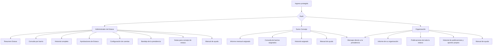
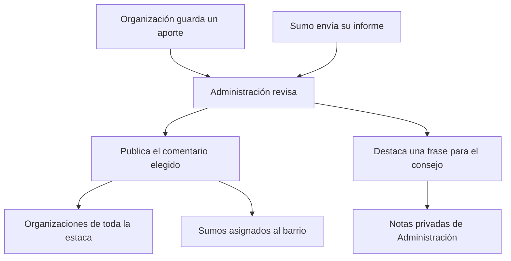

# Mapa de vistas — Informes Estaca Ñuñoa

## Permisos por perfil

| Vista | Administrador de Estaca | Sumo Consejo | Organización |
|---|---|---|---|
| Resumen Estaca | Todos los barrios | No | No |
| Ingreso de informe | Consulta y administra | Barrios asignados | Su organización, por barrio |
| Consulta por barrio | Todo, incluidos pendientes | Comentarios publicados de sumos y organizaciones en sus barrios asignados | Comentarios publicados de sumos y organizaciones en todos los barrios activos |
| Historial | Informes y organizaciones | Informes propios y publicaciones de sus barrios | Aportes propios y publicaciones de toda la estaca |
| Aprobaciones de Estaca | Sí | No | No |
| Administración de cuentas y barrios | Sí | No | No |
| Mensaje directo a la presidencia | Bandeja de todos los informantes | Envío e historial propio | Envío e historial propio |
| Destacar y consultar notas de consejo | Tabla común por mes | Acceso exclusivo de Administración | Acceso exclusivo de Administración |
| Manual de ayuda | Guía de administración | Guía de Sumo Consejo | Guía de su organización |

## Flujo de publicación

Cada comentario del Sumo Consejo tiene su propia aprobación. Cuando cambia un texto publicado, vuelve a revisión. Los demás comentarios aprobados conservan su publicación.
